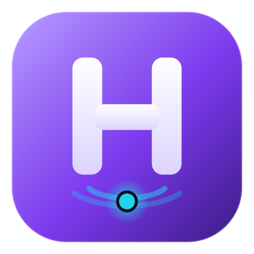
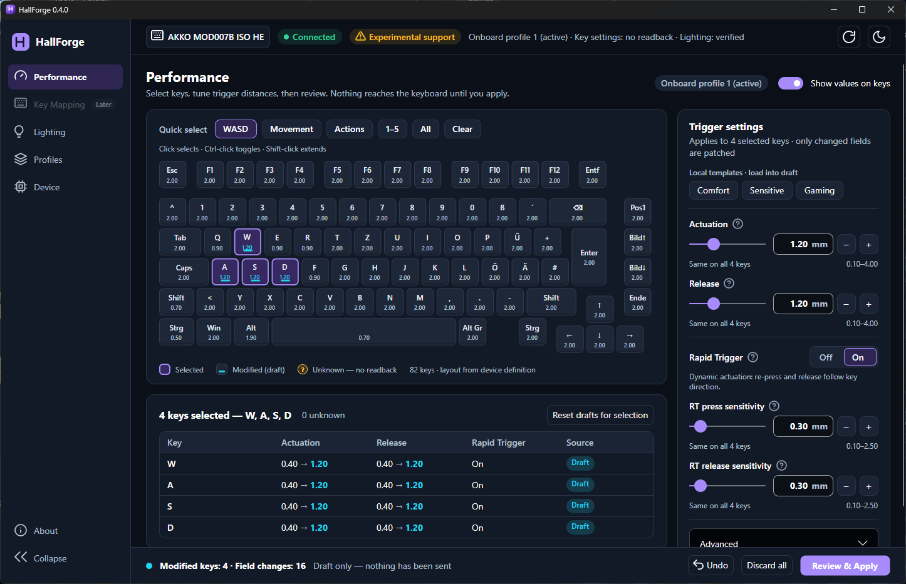
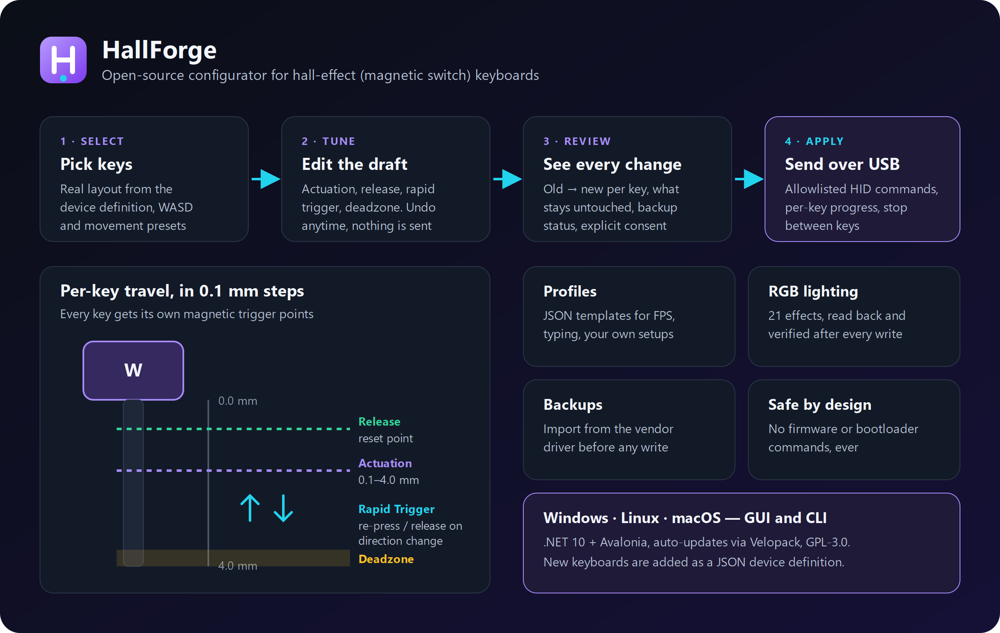
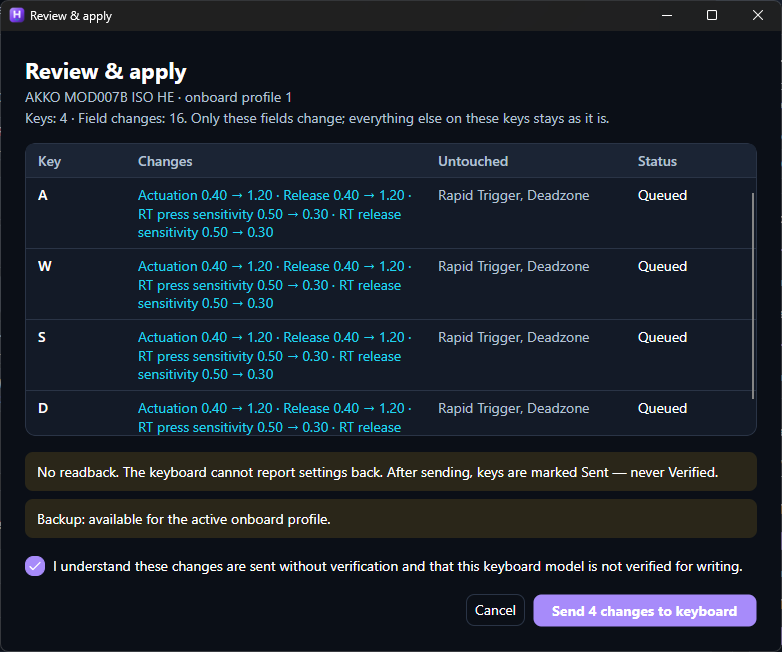
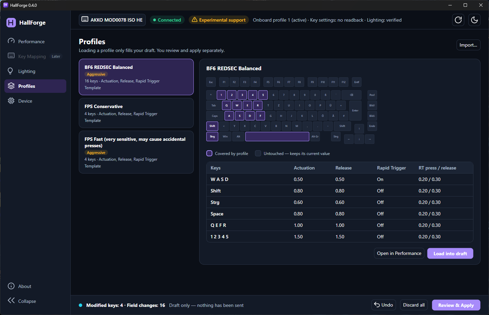
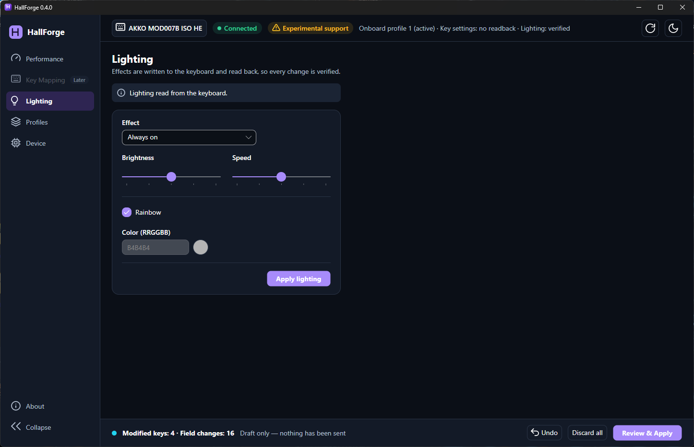
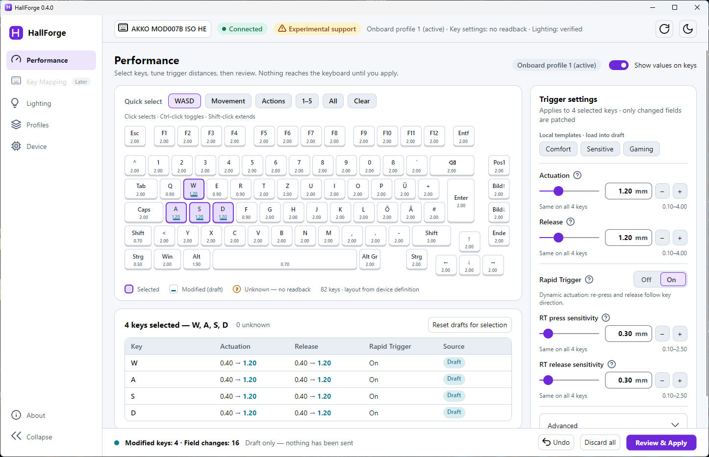

<p align="center">
  
</p>

<h1 align="center">HallForge</h1>

<p align="center">
  <strong>Open-source configurator for hall-effect (magnetic switch) keyboards.</strong><br>
  Per-key actuation point, release point, Rapid Trigger and deadzone, profiles, backups and RGB lighting.<br>
  Windows, Linux and macOS. GUI and command line.
</p>

<p align="center">
  <a href="https://github.com/Diddlik/hallforge/releases/latest"></a>
  <a href="https://github.com/Diddlik/hallforge/actions/workflows/ci.yml"></a>
  <a href="LICENSE"></a>
  
  
</p>

<p align="center">
  
</p>

HallForge replaces the vendor driver for tuning magnetic switches. Select keys on the real keyboard layout, set the actuation and release distance in 0.1 mm steps, enable Rapid Trigger with separate press and release sensitivity, review every change and send it over USB HID. Nothing reaches the keyboard before you confirm it.

**Status: experimental.** The first supported keyboard is the **AKKO MOD007B ISO HE** (RongYuan firmware, USB `3151:4035`). Key settings are written but the firmware cannot report them back. Lighting changes are read back and verified.

## Download

Get the latest version from **[GitHub Releases](https://github.com/Diddlik/hallforge/releases/latest)**:

| Platform | Installer (with automatic updates) | Portable / CLI |
|---|---|---|
| Windows x64 | `HallForge-win-Setup.exe` | `HallForge-win-Portable.zip`, `hallforge-cli-<version>-win-x64.zip` |
| Linux x64 | `HallForge.AppImage` | `hallforge-cli-<version>-linux-x64.zip` |
| macOS (Apple Silicon) | `HallForge-osx-Setup.pkg` | `HallForge-osx-Portable.zip`, `hallforge-cli-<version>-osx-arm64.zip` |

The installed app checks GitHub for updates when it starts, verifies the download and restarts only when you click "Restart and update". Automatic checks can be turned off under About.

## Features

- **Per-key actuation and release point**: 0.1 mm steps within the limits of the keyboard, with typed values, sliders and step buttons.
- **Rapid Trigger**: dynamic re-press and release with separate press and release sensitivity, plus bottom deadzone.
- **Multi-key editing**: quick selections (WASD, movement, actions, number row), Ctrl-click, Shift-click ranges, mixed values shown per field.
- **Draft, undo and review**: every edit stays a draft with undo. "Review & Apply" lists old and new values per key and sends with per-key progress. Sending can be stopped between keys.
- **Profiles**: JSON profiles for FPS games and typing, with a coverage preview. Templates for BF6 and FPS setups are included.
- **Backups**: imports the current settings from the AKKO Cloud Driver database before the first write.
- **RGB lighting**: 21 effects with brightness, speed, direction and color. Every lighting change is read back from the keyboard.
- **Roar mode**: up to four keys with the fastest response, chosen from the key selection. The backlight turns off while Roar is on, as in the AKKO driver. Every change is read back from the keyboard.
- **Travel mode and onboard profile**: switch Comfort, Sensitive, Gaming and Custom (like Fn+1 to Fn+4) and the active onboard profile on the Device page. Both are read back. The Performance page warns when the keyboard is not in Custom mode.
- **Switch per program** (Windows, opt-in): rules such as "bf6 → Gaming, profile 2" and one rule for all other programs. HallForge then keeps running in the tray. A switch sends only one or two short commands that are read back, never key settings.
- **Light and dark theme**, English and German UI, keyboard navigation and screen reader labels.
- **CLI** for scripting: list devices, back up, apply profiles, set keys and lighting with `--dry-run`.

<p align="center">
  
</p>

## Screenshots

| Review before writing | Profiles |
|---|---|
|  |  |
| **RGB lighting** | **Light theme** |
|  |  |

## Supported keyboards

| Keyboard | Firmware | Key settings | Lighting | Status |
|---|---|---|---|---|
| AKKO MOD007B ISO HE | RongYuan, model id 1778 | write (no readback) | read and write (verified) | experimental |

Other RongYuan based hall-effect keyboards (AKKO, MonsGeek and similar) probably use the same protocol. Adding one needs only a JSON device definition, see [Adding a keyboard](#adding-a-keyboard). Reports from other models are welcome as issues.

## FAQ

**What is a hall-effect keyboard?** Its switches use magnets and a hall sensor instead of a metal contact, so the keyboard measures how far each key is pressed. That makes the actuation point adjustable per key and enables Rapid Trigger.

**What is Rapid Trigger?** The key registers again as soon as it moves down by the press sensitivity, and releases as soon as it moves up by the release sensitivity, instead of using fixed points. It is popular in FPS games for fast counter-strafing.

**Is it safe?** HallForge never sends firmware, bootloader, key matrix or macro commands. Every write goes through an allowlist, needs a backup and is shown for review first. Unverified keyboards need an explicit acknowledgement.

**Do I need the vendor driver?** No. It is only used once as a source for the backup of your current settings. Close it while HallForge is running, because both talk to the same USB interface.

## Build from source

The build needs the .NET 10 SDK.

```bash
dotnet build
dotnet test
dotnet run --project src/HallForge.Cli -- devices list          # keyboards with a device definition
dotnet run --project src/HallForge.Cli -- devices list --all    # every HID interface
dotnet run --project src/HallForge.Cli -- devices probe --device <id> --output report.json
dotnet run --project src/HallForge.Cli -- devices identify --device <id>   # firmware model id and version (read-only)
dotnet run --project src/HallForge.Cli -- backup import-akko --device <id>   # back up the settings the Akko Cloud Driver stored
dotnet run --project src/HallForge.Cli -- state show --device <id>
dotnet run --project src/HallForge.Cli -- profiles apply profiles/bf6-balanced.json --device <id> --dry-run
dotnet run --project src/HallForge.Cli -- backup restore <backup.json> --device <id> --dry-run
dotnet run --project src/HallForge.Cli -- keys list --device <id>
dotnet run --project src/HallForge.Cli -- led show --device <id>          # current lighting effect (read-only)
dotnet run --project src/HallForge.Cli -- led set --device <id> --mode AlwaysOn --brightness 4 --color FF0000 --dry-run
dotnet run --project src/HallForge.Cli -- roar show --device <id>         # Roar mode keys (read-only)
dotnet run --project src/HallForge.Cli -- roar set --device <id> --keys KeyW KeyA KeyS KeyD --dry-run
dotnet run --project src/HallForge.Cli -- mode show --device <id>         # travel mode, as with Fn+1 to Fn+4
dotnet run --project src/HallForge.Cli -- mode set --device <id> --mode Custom
dotnet run --project src/HallForge.Cli -- profile set --device <id> --profile 2   # switch the active onboard profile
dotnet run --project src/HallForge.Cli -- keys set --device <id> --key AltLeft --actuation 1.9 --release 1.9 --rapid-trigger false --rt-press 0.2 --rt-release 0.3 --deadzone 3.7 --dry-run
dotnet run --project src/HallForge.App                          # GUI
```

`probe` writes an anonymized report. The report does not contain OS device paths or serial numbers.

## Adding a keyboard

- **The keyboard uses a protocol that HallForge already supports:** add a JSON file to `devices/`. See `devices/akko-mod007b-iso-he.json`. Run `devices identify` to get the firmware model id for `firmwareModelIds`. Set `"verified": false` until the keyboard has been tested on real hardware.
- **The keyboard uses a new protocol:** add a protocol project and give it a `protocol` id. Device definitions refer to that id.

## Using the GUI

- **Performance**: click keys or use Quick select, then change actuation, release, Rapid Trigger and the sensitivities in the side panel. Keys with a draft get a cyan bar; "Show values on keys" displays the actuation on every key.
- The bar at the bottom shows the draft. **Undo** steps back, **Discard all** clears it, **Review & Apply** opens the review dialog.
- **Profiles** loads a profile into the draft. **Lighting** reads the current effect and applies a new one. **Device** shows model, USB ID, active onboard profile and the backup.

## State and backups

The AKKO MOD007B ISO HE cannot report its key settings, so HallForge keeps what it knows:

- `backup import-akko` reads the settings that the Akko Cloud Driver stored in its local database (`%AppData%/Akko Cloud Driver/iot_db/CONFIG/db`). It saves them as an immutable backup and as the initial state. The driver only stores keys that differ from its defaults, so all other keys get the factory defaults from the device definition (`factoryDefaults`).
- `keys set` records every write in the state.
- Files live in `%AppData%/HallForge/state` and `%AppData%/HallForge/backups` (`~/.config/HallForge` on Linux and macOS).

## Profiles

Profiles are JSON files (see `profiles/`). Each group sets values for a list of key ids (W3C `KeyboardEvent.code` names such as `KeyW` or `ShiftLeft`). Later groups win, and the optional `keys` object overrides groups per key.

- A field that is left out stays unchanged. `null` is rejected.
- The keyboard only accepts complete key settings, so missing fields come from the known state. For a key whose state is unknown, the profile must set all six values.
- `profiles apply` shows every change per key before sending, needs a backup for the onboard profile, and asks for confirmation unless `--yes` is given. `--dry-run` sends nothing.
- `backup restore` uses the same path and checks that the backup matches the device, firmware model and active onboard profile.

## Releases and updates

Releases are built by `.github/workflows/release.yml` when a tag `v<version>` is pushed. The tag must match `<Version>` in `Directory.Build.props`. Velopack packages the GUI for Windows x64, Linux x64 and macOS arm64 and uploads it to GitHub Releases.

Installed apps check for updates over HTTPS when they start. You can turn this off under About. A downloaded update is verified by its hash and installed only when you select "Restart and update".

## Safety

- Firmware and bootloader commands are never exposed.
- Devices that are unknown stay read-only. Unverified devices are written only with `--experimental` and after confirmation.
- Every write sends the complete setting of one key. Values use '.' as decimal separator; ',' is rejected.
- The AKKO MOD007B ISO HE cannot report its settings back, so writes cannot be verified by reading them.
- HallForge opens only the vendor configuration interface, never the normal keyboard input interface.

## License

GPL-3.0-or-later. See [LICENSE](LICENSE).

Protocol research is based on [monsgeek-akko-linux](https://github.com/echtzeit-solutions/monsgeek-akko-linux) (GPL-3.0).

Third-party libraries:

| Library | License |
|---|---|
| Avalonia | MIT |
| CommunityToolkit.Mvvm | MIT |
| HidSharp | Apache-2.0 |
| System.CommandLine | MIT |
| Velopack | MIT |
| xUnit (tests only) | Apache-2.0 |
